<p align="center">
  
</p>

<h1 align="center">विरासत · Virasat</h1>
<p align="center"><b>A living heritage atlas.</b> From archival graveyard to living heritage map.</p>

<p align="center">
  Hackathon HC26-CULT01 · Digital Revitalisation of Unstructured Cultural and Architectural Heritage Archives · Blithchron '27, IIT Gandhinagar
</p>

---

## 1. The problem

Field fellowships produce a constant stream of heritage documentation: stepwell photographs, scans in regional scripts, architectural notes and travel journals. It ends up as static decks, disconnected cloud folders and text reports. This is the **archival graveyard**.

<p align="center"></p>

| What goes wrong today | Consequence |
|---|---|
| Records are scattered across folders and decks | Nobody can find what exists |
| Scans in Devanagari are images, not text | They cannot be searched or read by tools |
| Documents are not tied to a place | The story of a site is split from its location |
| No English reading aid for regional-language sources | Researchers outside the region cannot use them |

## 2. The solution in one paragraph

Virasat is a map-first atlas. A contributor uploads a photo or scan and picks the place it belongs to. A pipeline **reads the Devanagari text (OCR), translates it to English, tags it,** and links it to the place. The public explores places on an interactive map, reads each record with the **original and the translation side by side**, and **searches inside the records** in English or Devanagari.

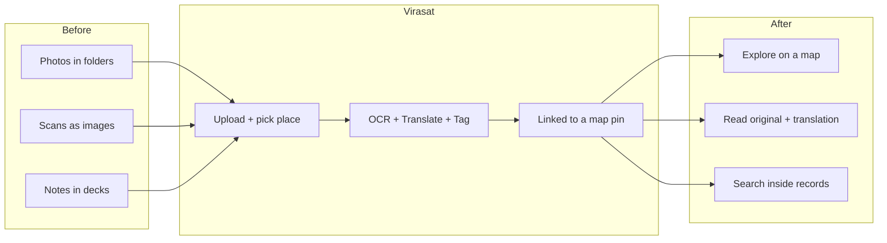

## 3. A tour of the platform

### Landing and guide
<p align="center">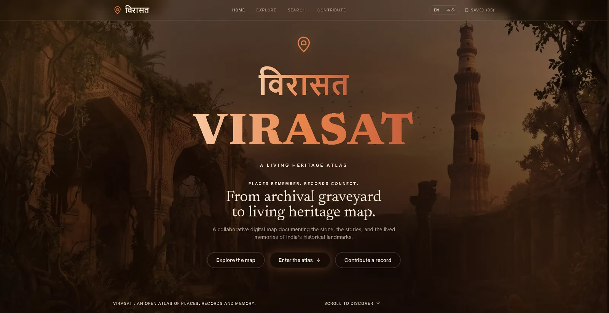</p>
<p align="center">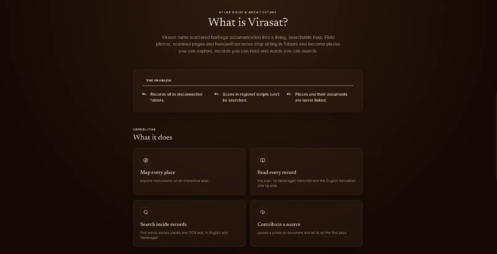</p>

### Explore: the map
Places appear as pins; filter chips narrow the map and the list together; the selected place shows its photo and summary.
<p align="center">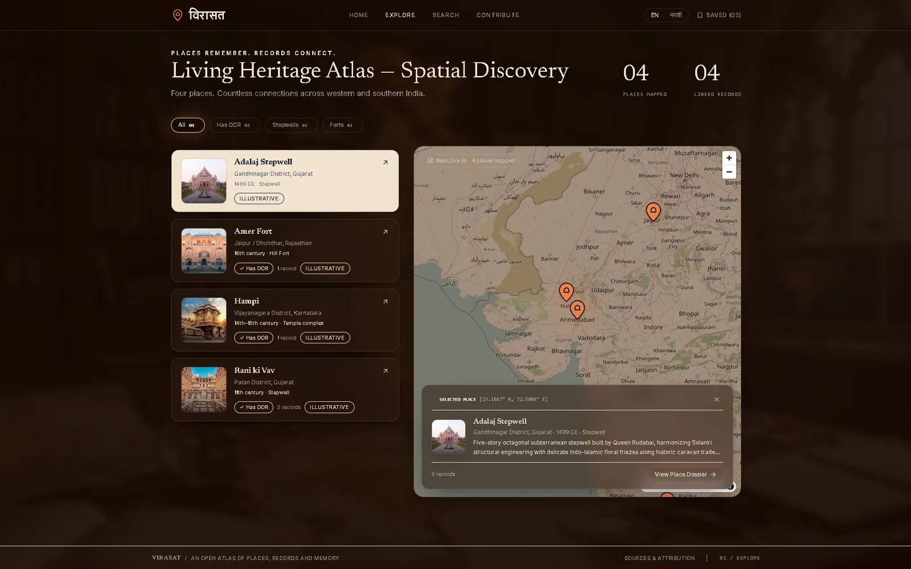</p>
<p align="center">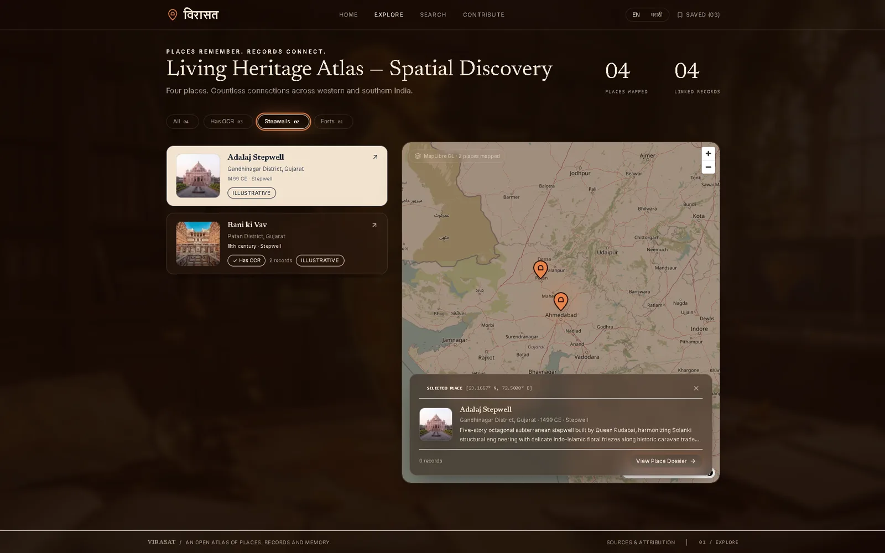</p>

### Place page: original and translation side by side
<p align="center">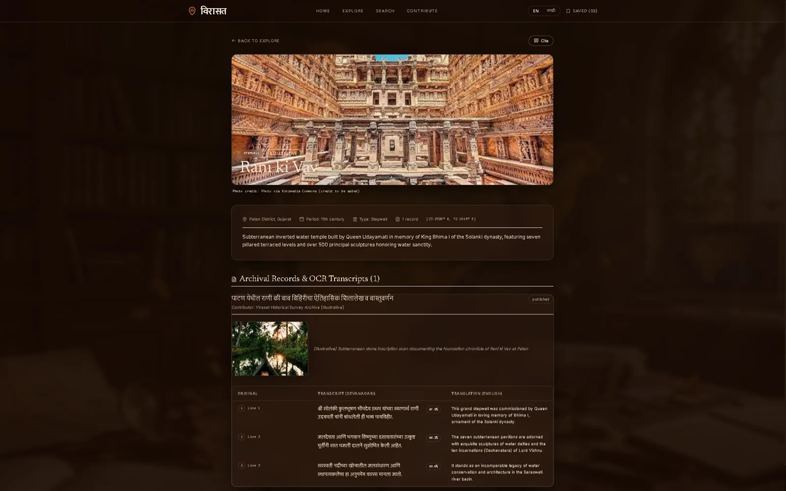</p>
<p align="center">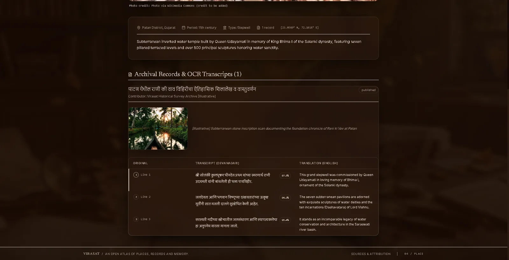</p>

### Contribute: upload with live pipeline status
<p align="center"></p>
<p align="center"></p>
<p align="center"></p>

### Search inside the records
<p align="center"></p>
<p align="center"></p>

### English and Marathi interface
The interface defaults to English; only the logo is Marathi by default, and the toggle switches the full interface.
<p align="center"></p>

## 4. How it works: the pipeline

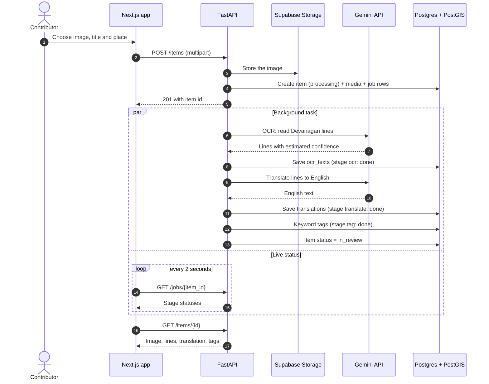

Every stage writes its own row to `processing_jobs` (pending, running, done or failed, with the error text), which is what the Contribute page polls. A failed stage never fails silently.

### Item lifecycle
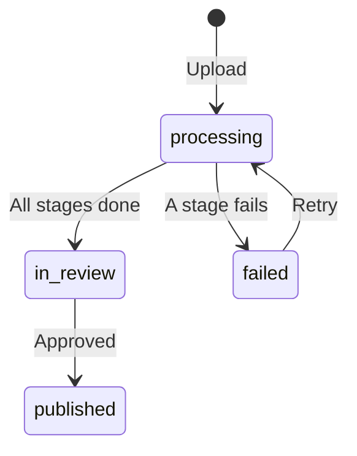

## 5. System architecture
<p align="center">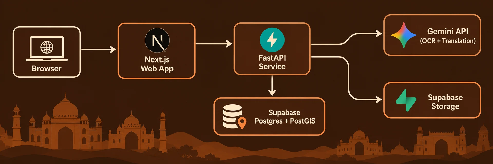</p>
<p align="center"><i>Simplified overview. The detailed diagram below also shows that the web app reads places and records directly from Supabase, while uploads, job status and search go through FastAPI.</i></p>
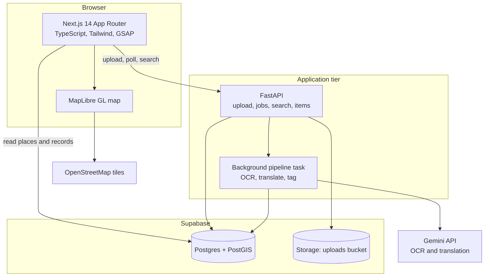

## 6. Data model

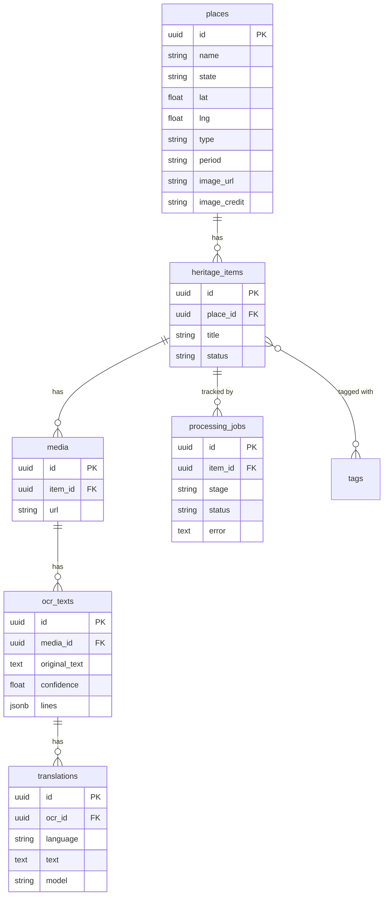
<p align="center"></p>

Full SQL: [`supabase/schema.sql`](supabase/schema.sql) and [`supabase/seed.sql`](supabase/seed.sql).

## 7. Who uses it and how

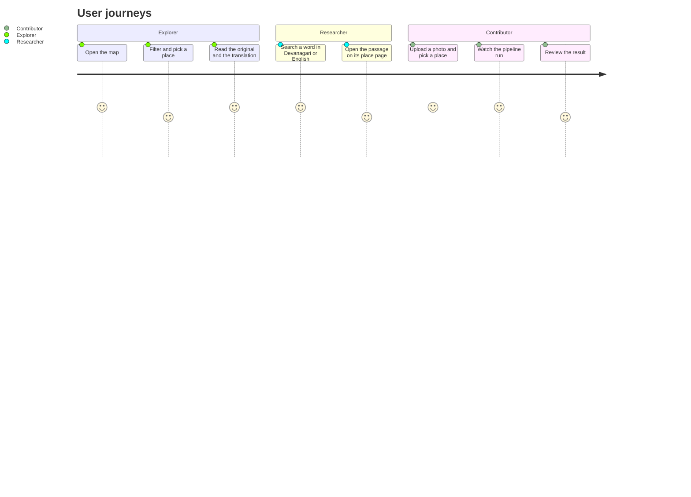

## 8. API

The interactive documentation is generated by FastAPI at `http://localhost:8000/docs`.

<p align="center"></p>

| Method | Path | Purpose |
|---|---|---|
| GET | `/` | Root health check and service metadata |
| POST | `/items` | Upload an image with title and place, start the background pipeline |
| GET | `/jobs/{item_id}` | Stage-by-stage processing status (polled by Contribute page) |
| GET | `/items/{id}` | Item dossier with image, OCR lines, translation and tags |
| POST | `/items/{id}/retry` | Re-run the background pipeline for an existing item (API endpoint) |
| POST | `/items/{id}/approve` | Moderate and approve an in-review item for published display |
| GET | `/admin/items` | Moderation queue: list items by status (`in_review`, `published`, `all`) |
| GET | `/search?q=&type=&state=` | Search places and OCR passages across English and Devanagari |

## 9. Tech stack and why

| Layer | Choice | Reason |
|---|---|---|
| Web | Next.js 14, TypeScript, Tailwind, GSAP | Fast routing and UI; animation for a calm, archival feel |
| Map | MapLibre GL with OpenStreetMap tiles | No API key or vendor lock-in |
| API | FastAPI (Python) | Typed endpoints and background tasks |
| Database | Supabase Postgres + PostGIS | One store for relational and geospatial data |
| Storage | Supabase Storage | Simple, CDN-ready media hosting |
| AI | Gemini API | Reads Devanagari images and translates in one provider |

### Libraries and APIs used

#### Frontend (`apps/web/package.json`)
| Package | Version | Purpose |
|---|---|---|
| `next` | `14.2.35` | React framework (App Router, dynamic routing, image optimization) |
| `react` & `react-dom` | `^18` | Core UI component model |
| `typescript` | `^5` | Strict static typing across components and data loaders |
| `tailwindcss` | `^3.4.1` | Utility-first CSS styling and custom heritage design tokens |
| `maplibre-gl` | `^6.16.0` | Open-source vector/raster map rendering with custom pin markers |
| `gsap` & `@gsap/react` | `^3.15.0` / `^2.1.2` | Hero Ken Burns zoom, smooth scroll-triggered reveals |
| `framer-motion` | `^14.7.1` | Selected place panel sliding animation and interactive transitions |
| `lucide-react` | `^1.63.0` | Iconography for heritage controls, badges, and statuses |
| `@supabase/supabase-js` | `^2.118.0` | Client SDK for direct Supabase Postgres queries |
| `postcss` | `^8` | CSS post-processing pipeline for Tailwind |
| `eslint` & `eslint-config-next` | `^8` / `14.2.35` | Code quality and Next.js linting rules |

#### Backend (`apps/api/requirements.txt`)
| Package | Version | Purpose |
|---|---|---|
| `fastapi` | `>=0.110.0` | High-performance Python async web framework |
| `uvicorn[standard]` | `>=0.28.0` | Production ASGI server with event loop implementation |
| `google-genai` | `>=2.0.0` | Official Google Gemini SDK for Devanagari OCR and English translation |
| `supabase` | `>=2.3.0` | Supabase Python client for PostGIS queries and Storage uploads |
| `httpx` | `>=0.27.0` | HTTP client for downloading image assets and preflight testing |
| `pydantic` | `>=2.6.0` | Typed request validation and structured API response schemas |
| `Pillow` | `>=10.0.0` | Image verification, decoding, and format inspection |
| `python-multipart` | `>=0.0.9` | Multipart form-data parser for archival image uploads |
| `python-dotenv` | `>=1.0.1` | Environment variable parsing from `.env` |
| `pytest` | `>=8.0.0` | API test suite execution |

## 10. Design decisions

- **Original and translation always side by side.** The AI layer never replaces the source.
- **AI is visible, not magic.** Each stage shows its status, and the confidence is labelled as model-estimated.
- **Every failure is surfaced.** Stage errors are stored and shown, not swallowed.
- **Seed data is labelled ILLUSTRATIVE.** We never present demo content as historical fact.
- **Photos are credited.** Place images are from Wikimedia Commons, listed on the Sources page.

## 11. Scalability path

| Today | At scale |
|---|---|
| Background task in the API process | A queue with horizontally scaled workers |
| One Supabase project | Read replicas for search-heavy reads |
| Keyword search (case-insensitive match) | Postgres full-text, then `pgvector` semantic search |
| Public bucket | CDN in front of storage, signed uploads |
| General-purpose model OCR | Dedicated Indic OCR (PaddleOCR) and IndicTrans2 translation |

The API and web tiers are stateless, so both scale behind a load balancer.

## 12. Honest limitations

- The OCR confidence is **model-estimated, not a measured accuracy**.
- There are **no bounding boxes** yet, so highlighting a line on the scan is not implemented.
- Search is **keyword-based**, not semantic.
- There is **no authentication**; the admin page is a prototype.
- The pipeline retry endpoint is implemented on the API (`POST /items/{id}/retry`), but **not yet wired to an interactive button in the web UI** (users can restart via "Contribute another record").
- Seed places and records are **illustrative**.
- OCR quality depends on image quality; handwriting is harder than print.

## 13. Roadmap

1. Bounding-box OCR with scan-to-text highlighting
2. Dedicated Indic OCR and IndicTrans2
3. Semantic search with pgvector
4. Authentication, roles and a moderation workflow
5. Offline field capture (PWA)
6. 3D digital twins from crowdsourced photos, linked to OCR annotations

## 14. How this maps to the judging criteria

| Criterion | Where to look |
|---|---|
| Technical execution (40%) | A working end-to-end pipeline: upload, OCR, translate, tag, search (sections 3 and 4) |
| Architecture and scalability (30%) | Sections 5, 6 and 11 |
| UI/UX (20%) | Section 3 and the English/Marathi interface |
| Innovation and problem fit (10%) | Sections 1 and 2: the archival graveyard turned into a searchable map |

## 15. Run it locally

**Requirements:** Node 18.17+, Python 3.10+, a Supabase project and a Gemini API key.

1. In Supabase, run `supabase/schema.sql` and then `supabase/seed.sql` in the SQL Editor, and create a public Storage bucket named `uploads`.
2. Create `apps/web/.env.local`:
```
NEXT_PUBLIC_SUPABASE_URL=...
NEXT_PUBLIC_SUPABASE_PUBLISHABLE_KEY=...
NEXT_PUBLIC_API_URL=http://localhost:8000
```
3. Create `apps/api/.env`:
```
GEMINI_API_KEY=...
SUPABASE_URL=...
SUPABASE_SERVICE_ROLE_KEY=...
```
4. Start the API:
```
cd apps/api
python -m venv .venv
.venv\Scripts\Activate.ps1
pip install -r requirements.txt
uvicorn main:app --port 8000
```
5. Start the web app in a second terminal:
```
cd apps/web
npm install
npm run dev
```
6. Open http://localhost:3000.

## 16. Repository structure

```
virasat/
├── apps/
│   ├── web/          Next.js app (pages, components, i18n, map)
│   └── api/          FastAPI service and OCR pipeline
├── supabase/         schema.sql and seed.sql
├── docs/             architecture notes and README images
└── README.md
```

## 17. Credits
Banner, problem and architecture illustrations were generated with AI and are artistic impressions, not photographs of the sites. Place photographs are from Wikimedia Commons.

Map data © OpenStreetMap contributors. Place photographs from Wikimedia Commons; individual credits are on the Sources page. Built for HC26-CULT01.