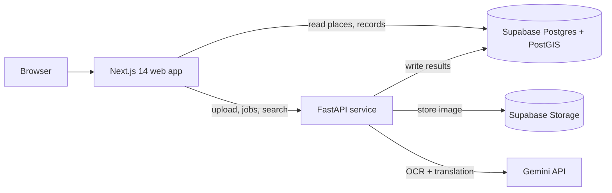
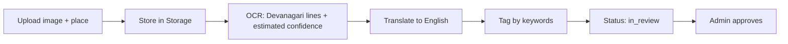
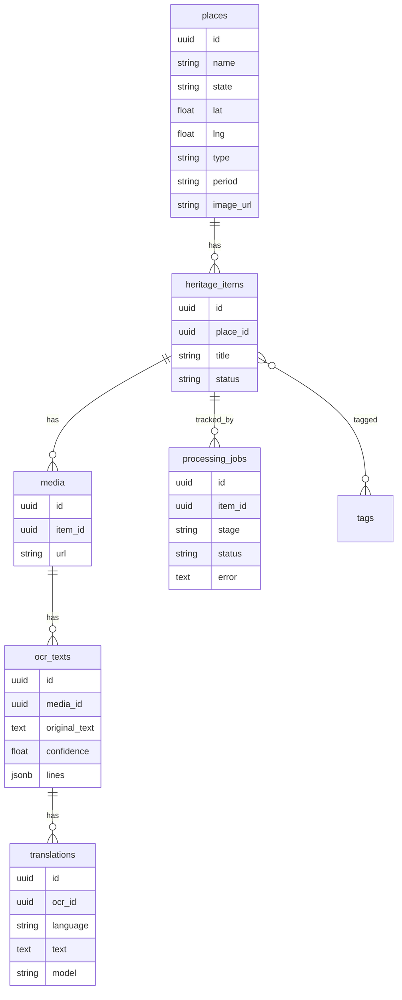

# Virasat (विरासत) — A Living Heritage Atlas

Hackathon: HC26-CULT01, Digital Revitalisation of Unstructured Cultural & Architectural Heritage Archives (Blithchron '27, IIT Gandhinagar).

Virasat turns scattered heritage documentation (field photos, scanned pages, handwritten notes in Devanagari) into a searchable, map-based atlas. A contributor uploads a source; an AI pipeline reads the text, translates it and tags it; the record is linked to a place on an interactive map and becomes searchable.

> Seed places and sample records are marked ILLUSTRATIVE. AI output is a starting point, not historical verification.

## Features
- Interactive heritage map (MapLibre) with place filters and a place detail page
- Side-by-side original Devanagari text and English translation per record
- Upload pipeline with live stage status: OCR, translation, tagging
- Search across places and OCR text (English and Devanagari)
- Admin review page for new contributions (prototype, no auth)
- English / Marathi interface toggle

## Architecture


### Pipeline

Each stage writes a row to `processing_jobs`, which the Contribute page polls to show live progress.

## Database schema

Full SQL: `supabase/schema.sql` and `supabase/seed.sql`.

## Tech stack
Next.js 14 (App Router, TypeScript, Tailwind, GSAP), MapLibre GL, FastAPI (Python), Supabase (Postgres + PostGIS + Storage), Gemini API for OCR and translation.

## Setup
1. Create a Supabase project, run `supabase/schema.sql` then `supabase/seed.sql` in the SQL Editor, and create a public Storage bucket named `uploads`.
2. `apps/web/.env.local`:
```
NEXT_PUBLIC_SUPABASE_URL=...
NEXT_PUBLIC_SUPABASE_PUBLISHABLE_KEY=...
NEXT_PUBLIC_API_URL=http://localhost:8000
```
3. `apps/api/.env`:
```
GEMINI_API_KEY=...
SUPABASE_URL=...
SUPABASE_SERVICE_ROLE_KEY=...
```
4. Run the API: `cd apps/api && python -m venv .venv && .venv\Scripts\Activate.ps1 && pip install -r requirements.txt && uvicorn main:app --port 8000`
5. Run the web app: `cd apps/web && npm install && npm run dev`, then open http://localhost:3000

## Scalability notes
Stateless API and web tiers; the OCR pipeline is a background task that can move to a queue (Celery or a cloud queue) with horizontal workers; PostGIS handles spatial queries; media can sit behind a CDN; Postgres full-text and `pgvector` give a migration path to semantic search.

## Limitations (honest)
- OCR and translation use a general model (Gemini); the confidence value is model-estimated, not a measured accuracy score
- No bounding boxes yet, so scan-to-text highlighting is not implemented
- Search is keyword-based (case-insensitive match), not semantic
- No user authentication; the admin page is a prototype
- Seed data is illustrative; place photos are from Wikimedia Commons (see /sources)

## Roadmap
Bounding-box OCR with scan highlighting, dedicated Indic OCR (PaddleOCR / IndicTrans2), semantic search with pgvector, authentication and roles, a moderation workflow, offline field capture (PWA), and 3D digital twins from crowdsourced photos.

## Credits
Map data (c) OpenStreetMap contributors. Place photos: see /sources.
