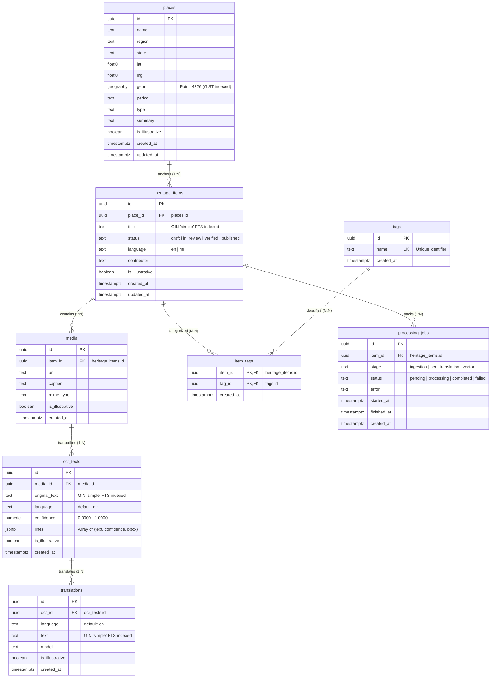

# Virasat (विरासत) — Database Schema & Architecture

> **Hackathon Track:** HC26-CULT01  
> **Core Objective:** Transform unstructured heritage archives into a searchable, interactive, map-first heritage atlas.  
> **Database Engine:** PostgreSQL 15+ with PostGIS spatial extension (Supabase)

---

## 1. Entity-Relationship (ER) Diagram



---

## 2. Table Specifications

### `places`
Spatial anchors representing monuments, archaeological ruins, stepwells, and cultural sites.
- **`id`** (`uuid`, PK): Unique site identifier (`gen_random_uuid()`).
- **`name`** (`text`, NOT NULL): Official monument / place name.
- **`region`** (`text`): District, historic region, or river basin (e.g. *Patan District*, *Dhundhar*).
- **`state`** (`text`, NOT NULL): Indian state or administrative territory.
- **`lat`** (`double precision`, NOT NULL): WGS84 latitude.
- **`lng`** (`double precision`, NOT NULL): WGS84 longitude.
- **`geom`** (`geography(point, 4326)`, NOT NULL): PostGIS point geography column indexed with **GIST** for spatial radius and bounding box searches.
- **`period`** (`text`): Historical era or dynasty (e.g. *11th century*, *1499 CE*, *16th century*).
- **`type`** (`text`): Typological categorization (e.g. *Stepwell*, *Hill Fort*, *Temple complex*).
- **`summary`** (`text`): Curated spatial and historical abstract.
- **`is_illustrative`** (`boolean`, DEFAULT `true`): Conformance flag indicating whether the record is seed/mock data per `AGENTS.md`.

### `heritage_items`
Curated records, archival entries, inscriptions, and oral memory documents linked to specific places.
- **`id`** (`uuid`, PK): Item identifier.
- **`place_id`** (`uuid`, FK &rarr; `places.id`): Parent site anchor.
- **`title`** (`text`, NOT NULL): Title of the record (indexed via **GIN** full-text search with `simple` dictionary).
- **`status`** (`text`, DEFAULT `'draft'`): Workflow stage (`draft`, `in_review`, `verified`, `published`, `archived`).
- **`language`** (`text`, DEFAULT `'en'`): Primary language code of the record (`en`, `mr`, `gu`, `hi`, `sa`).
- **`contributor`** (`text`): Submitting institution, archivist, or researcher.
- **`is_illustrative`** (`boolean`, DEFAULT `true`): Seed integrity label.

### `media`
Primary scanned manuscripts, stone rubbings, historical photographs, and field audio.
- **`id`** (`uuid`, PK): Media identifier.
- **`item_id`** (`uuid`, FK &rarr; `heritage_items.id`): Associated parent record.
- **`url`** (`text`, NOT NULL): Hosted asset storage URL (e.g. Supabase Storage bucket).
- **`caption`** (`text`): Archival source description and provenance.
- **`mime_type`** (`text`): Asset format (`image/jpeg`, `image/png`, `audio/mpeg`, `application/pdf`).

### `ocr_texts`
Extracted textual data from inscriptions, paper archives, or architectural registers.
- **`id`** (`uuid`, PK): OCR record identifier.
- **`media_id`** (`uuid`, FK &rarr; `media.id`): Source media file.
- **`original_text`** (`text`, NOT NULL): Full raw text in source language (indexed with **GIN** `simple`).
- **`language`** (`text`, DEFAULT `'mr'`): Language code (Marathi, Modi, Sanskrit, etc.).
- **`confidence`** (`numeric(5, 4)`): Overall OCR confidence score ($0.0000 \le c \le 1.0000$).
- **`lines`** (`jsonb`, NOT NULL): Structured line-level extractions with coordinate bounding boxes.

#### Line-level JSONB Structure (`lines` column)
```json
[
  {
    "text": "श्री सोलंकी कुलभूषण भीमदेव प्रथम यांच्या स्मरणार्थ राणी उदयमती यांनी बांधलेली ही भव्य पायविहीर.",
    "confidence": 0.9750,
    "bbox": [0.082, 0.115, 0.915, 0.178]
  },
  {
    "text": "जलदेवता आणि भगवान विष्णूच्या दशावतारांच्या उत्कृष्ट मूर्तींनी सात मजली दालने सुशोभित केली आहेत.",
    "confidence": 0.9620,
    "bbox": [0.084, 0.201, 0.898, 0.264]
  }
]
```
> **BBox Coordinate Format:** Normalized $[x_{min}, y_{min}, x_{max}, y_{max}]$ coordinates relative to media dimensions ($0.0 \dots 1.0$).

### `translations`
Machine translations and verified scholarly interpretations of archival texts.
- **`id`** (`uuid`, PK): Translation identifier.
- **`ocr_id`** (`uuid`, FK &rarr; `ocr_texts.id`): Source OCR transcription.
- **`language`** (`text`, DEFAULT `'en'`): Target translation language.
- **`text`** (`text`, NOT NULL): Translated text (indexed with **GIN** `simple`).
- **`model`** (`text`): Attribution of translation pipeline (e.g. *Bhashini NLLB 3.3B*, *IndicTrans2*).

### `tags` & `item_tags`
Taxonomic tagging structure allowing many-to-many associations between heritage assets and architectural themes (e.g. *stepwell*, *solanki-dynasty*, *water-heritage*, *epigraphy-inscription*).

### `processing_jobs`
State machine tracking asynchronous background processing for archival ingestion, OCR, translation, and vector embedding pipelines.
- **`stage`**: `ingestion` | `preprocessing` | `ocr` | `translation` | `vector_indexing`
- **`status`**: `pending` | `processing` | `completed` | `failed`

---

## 3. Indexing & Spatial Search Strategy

### PostGIS Spatial Indexing (`GIST`)
```sql
create index idx_places_geom on places using gist (geom);
```
Enables sub-millisecond spatial bounding box and distance queries:
```sql
-- Find places within 50km radius of Ahmedabad / Adalaj
select id, name, type, st_distance(geom, st_setsrid(st_makepoint(72.5800, 23.1667), 4326)::geography) as dist_meters
from places
where st_dwithin(geom, st_setsrid(st_makepoint(72.5800, 23.1667), 4326)::geography, 50000)
order by dist_meters asc;
```

### Full-Text Search Indexing (`GIN` with `simple` Configuration)
```sql
create index idx_heritage_items_title_fts on heritage_items using gin (to_tsvector('simple', title));
create index idx_ocr_texts_fts on ocr_texts using gin (to_tsvector('simple', original_text));
create index idx_translations_fts on translations using gin (to_tsvector('simple', text));
```

#### Rationale for the `'simple'` Text Configuration:
1. **Multilingual Preservation**: Standard configurations like `'english'` apply English-specific stemming algorithms and strip non-English stopwords, which corrupts Devanagari, Marathi, Gujarati, Sanskrit, and transliterated terms.
2. **Exact Token Matching**: The `'simple'` configuration lowercases Latin characters while preserving raw Unicode/Devanagari tokens verbatim, ensuring reliable cross-lingual searches across historical names (e.g. *उदयमती*, *Solanki*, *Vav*, *बावडी*, *Hampi*).

---

## 4. Seed Data Verification & Integrity

The seed file (`supabase/seed.sql`) populates 4 core heritage anchors with authentic spatial coordinates and 3 detailed illustrative Marathi OCR archival records:

| Site | State | Coordinates (Lat, Lng) | Typology | Seed Item Title |
| :--- | :--- | :--- | :--- | :--- |
| **Rani ki Vav** | Gujarat | `23.8589° N, 72.1016° E` | Stepwell | *[Illustrative] पाटण येथील राणी की वाव विहिरीचा ऐतिहासिक शिलालेख व वास्तुवर्णन* |
| **Adalaj Stepwell** | Gujarat | `23.1667° N, 72.5800° E` | Stepwell | *(Site Anchor)* |
| **Amer Fort** | Rajasthan | `26.9855° N, 75.8513° E` | Hill Fort | *[Illustrative] आमेर दुर्गाचे संरक्षण आणि मावठा सरोवर जलप्रवाह दप्तर नोंद* |
| **Hampi** | Karnataka | `15.3350° N, 76.4600° E` | Temple Complex | *[Illustrative] विजयनगर साम्राज्यातील हंपी विठ्ठल मंदिराचा वास्तुशास्त्रीय वृत्तांत* |

All seed records comply with Section 5 of [AGENTS.md](file:///d:/Antigravity/Programs/Projects/HackCult/virasat/AGENTS.md) by bearing explicit `[Illustrative]` labels and setting `is_illustrative = true`.
